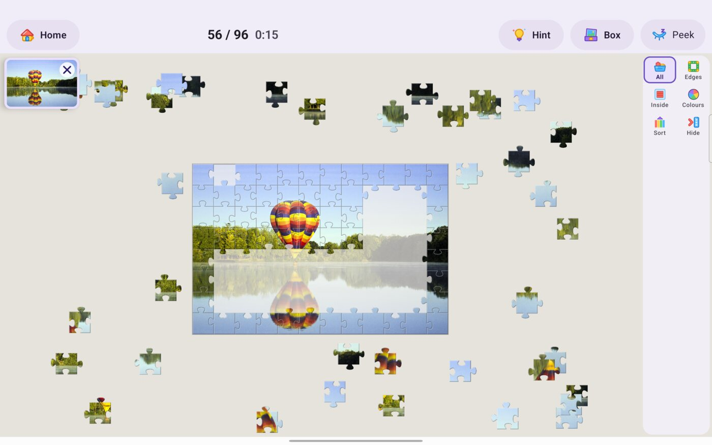
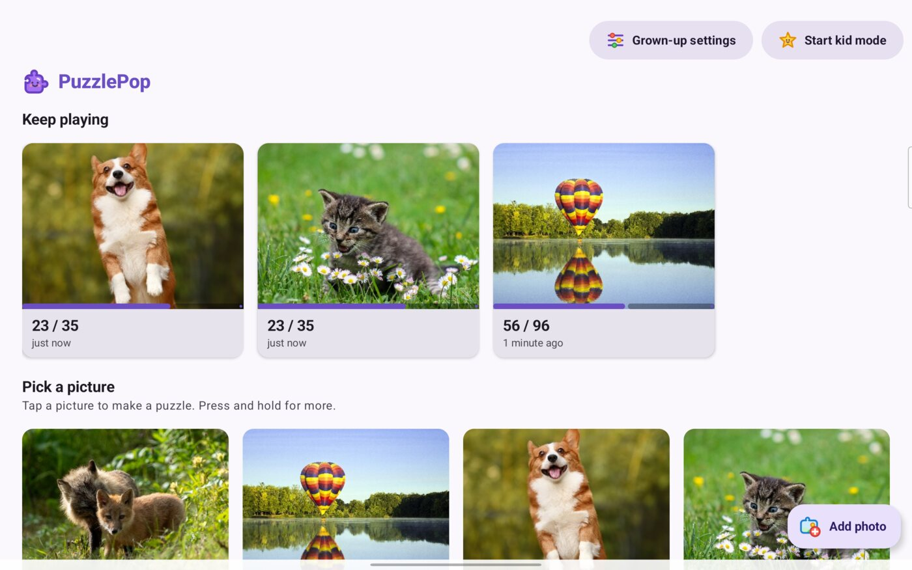
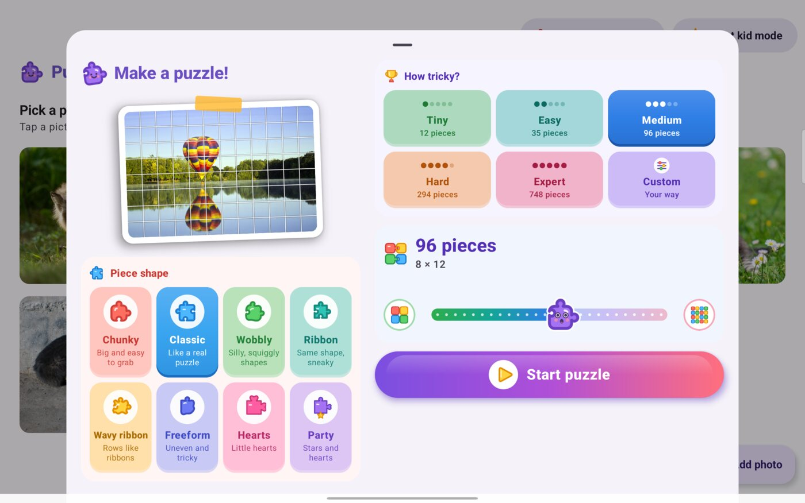
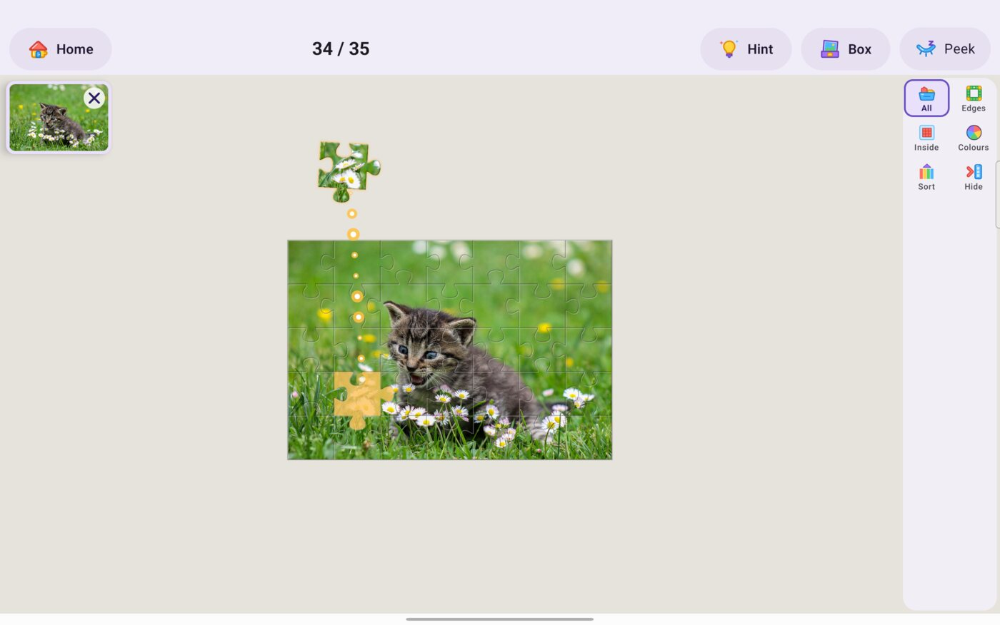
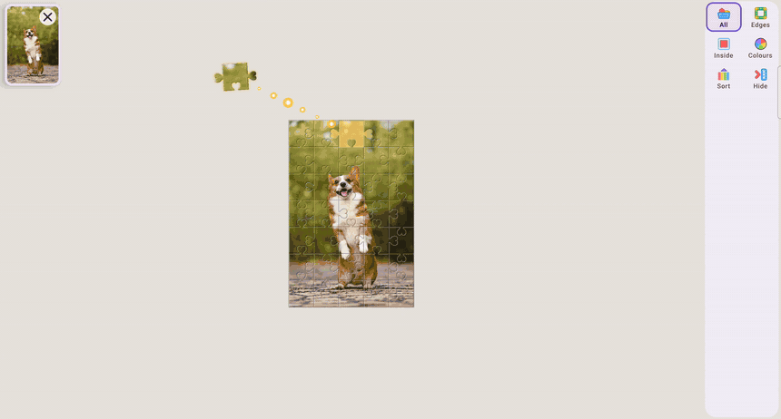
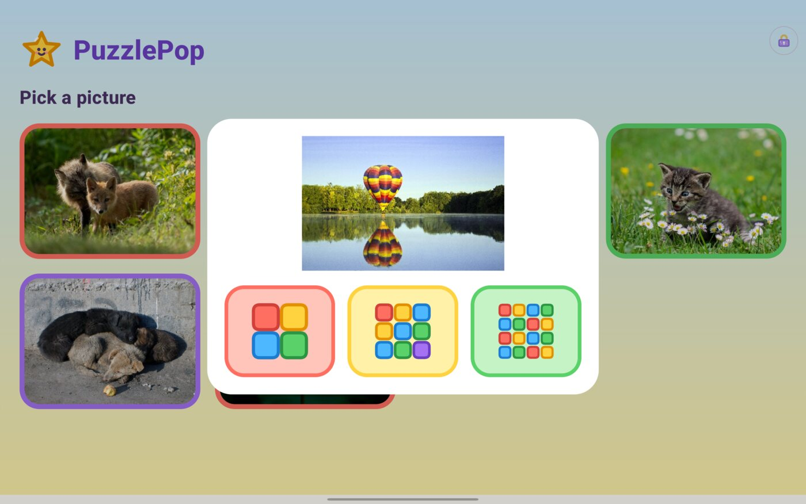
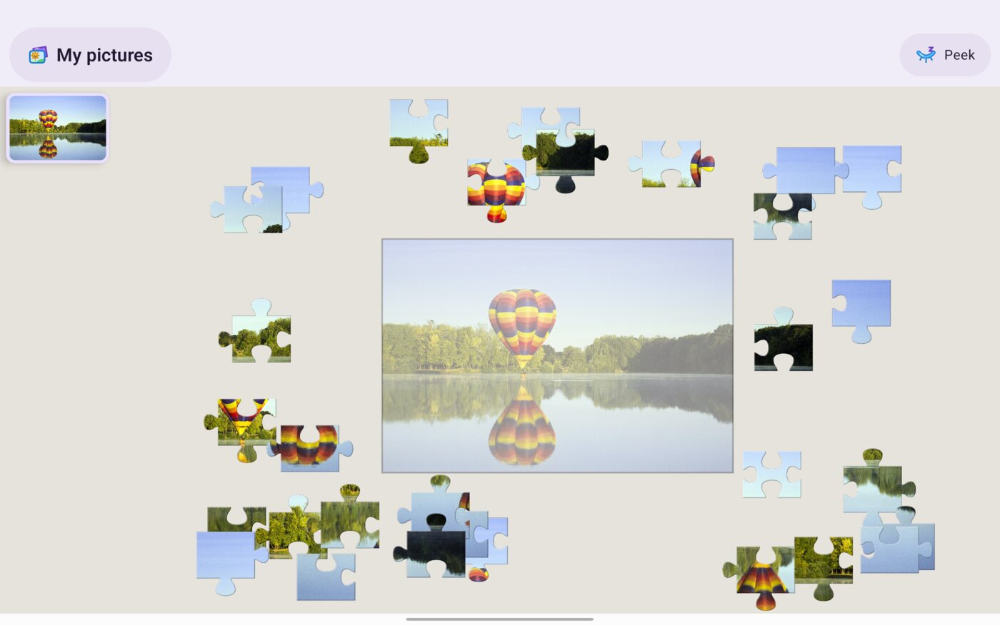
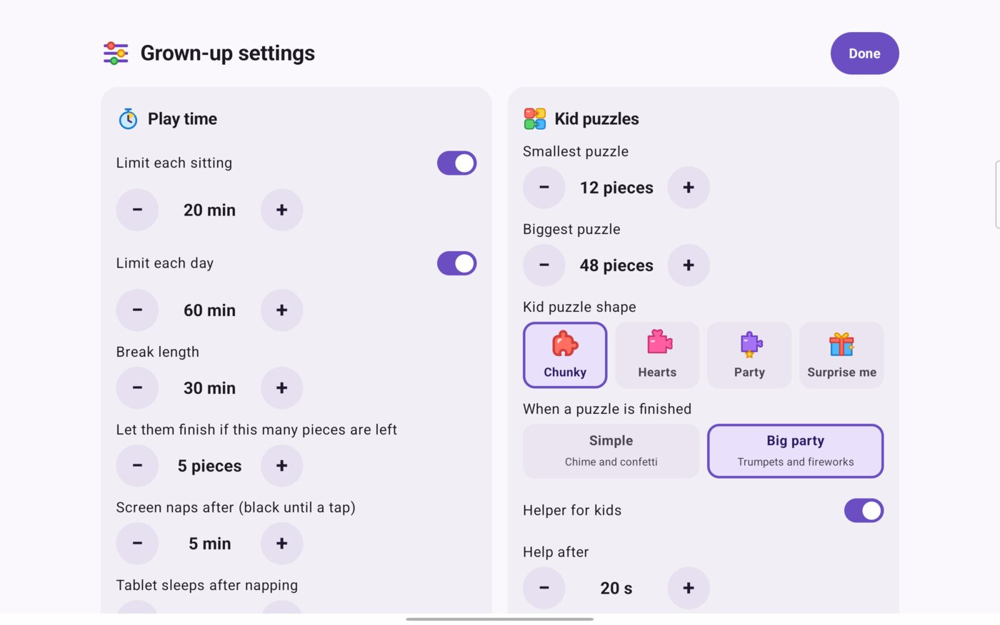

# PuzzlePop

Jigsaw puzzles made from your own photos, for Android tablets.

I had Claude build this for my kids. It turns your own photos into puzzles, has
a kid mode you can safely hand a tablet over with, and still goes up to 1000
pieces when the grown-ups want a turn.

No ads, no accounts, no analytics. It doesn't even ask for internet access.
It isn't on the Play Store, so you build it and install the APK yourself.



## Making a puzzle

Add photos from the gallery or take one with the camera. Tap a photo, pick how
hard (10 to 1000 pieces) and a piece shape, and go. Puzzles save as you play,
so you can leave and come back later.

<p>
  
  
</p>

There are eight piece shapes. Chunky has big rounded tabs for small hands,
Classic looks like a normal jigsaw, and Wobbly, Ribbon, Wavy ribbon, Freeform,
Hearts and Party are odder and harder to read.

## While you play

The tray on the right filters the loose pieces to edges, insides or one
colour, or sorts them by colour. The box picture stays in the corner. You can
turn on piece rotation if you want it harder. If you're stuck, Hint picks a
piece and shows where it goes.

<p>
  
  
</p>

When you finish you get confetti, or trumpets and fireworks if you'd rather.
It also keeps your best time for each photo and difficulty.

## Kid mode

Kid mode is the part I cared most about. It pins the app to the screen so a
toddler can't swipe out, and it hides everything that could delete or change
things. Kids see their pictures and three puzzle sizes, nothing else. Pieces
are chunky, and they pull into place when dropped close enough, so it's hard
to get stuck.

<p>
  
  
</p>

To get out, press and hold the lock button, then unlock the tablet with its
normal lock screen. You pick which photos show up in kid mode by long-pressing
them in the library. Grown-up settings (behind a fingerprint or the app PIN)
cover the rest:

- time limits per sitting and per day, with a break screen (and an "almost
  done" allowance so they can finish the puzzle they're on)
- the smallest and biggest puzzle sizes kids can pick
- the piece shape kids get, and whether a helper hint shows up after a while
- a screen nap that goes black after a few idle minutes



The app is in English and Korean. The Korean was written with machine help and
hasn't been checked by a native speaker, so corrections are welcome.

It was built for Samsung Galaxy Tab S7+ and S8+ tablets. Phones work, but the
layout is designed for a tablet in landscape.

## Requirements

- Android 13 or newer on the device
- To build: JDK 17+ and the Android SDK (platform 36). Android Studio is not required.

## Building

```bash
./gradlew assembleDebug
```

The APK ends up in `app/build/outputs/apk/debug/`. The debug build is called
"PuzzlePop (test)" and installs alongside a release build, with its own data.

Run the unit tests:

```bash
./gradlew test
```

### Release builds

Release signing is optional. If `~/.puzzlepop/keystore.properties` exists, the
release build is signed with it:

```properties
storeFile=/home/you/.puzzlepop/puzzlepop-release.jks
storePassword=...
keyAlias=puzzlepop
keyPassword=...
```

You can make a key with:

```bash
keytool -genkeypair -v -keystore ~/.puzzlepop/puzzlepop-release.jks -keyalg RSA -keysize 2048 -validity 10000 -alias puzzlepop
```

Then run `./gradlew assembleRelease`. Back up the key. Android only allows
updates signed with the same key, and without it you have to uninstall the app,
which deletes all its photos and puzzles.

See [docs/INSTALL.md](docs/INSTALL.md) for getting the APK onto a tablet.

## Layout

- `engine/`: plain Kotlin with no Android dependencies. Piece cutting, grid
  sizing, game state and save files. Most of the tests live here.
- `app/`: the Android app (Jetpack Compose, Room, DataStore). Library, play
  screen, kid mode, settings.
- `tools/`: scripts that generate the sound effects, the launcher icon and test
  images. All the assets in the app are generated by these or drawn as vector XML.

## Photos in the screenshots

All from Wikimedia Commons, CC0 or public domain: kitten by Ilona Ilyés,
corgi by Huoadg5888, hot air balloon by Bonnie Moreland, foxes by USFWS
Alaska, puppies by Martin Vorel, lotus by Hong Zhang.

## License

MIT. See [LICENSE](LICENSE).
